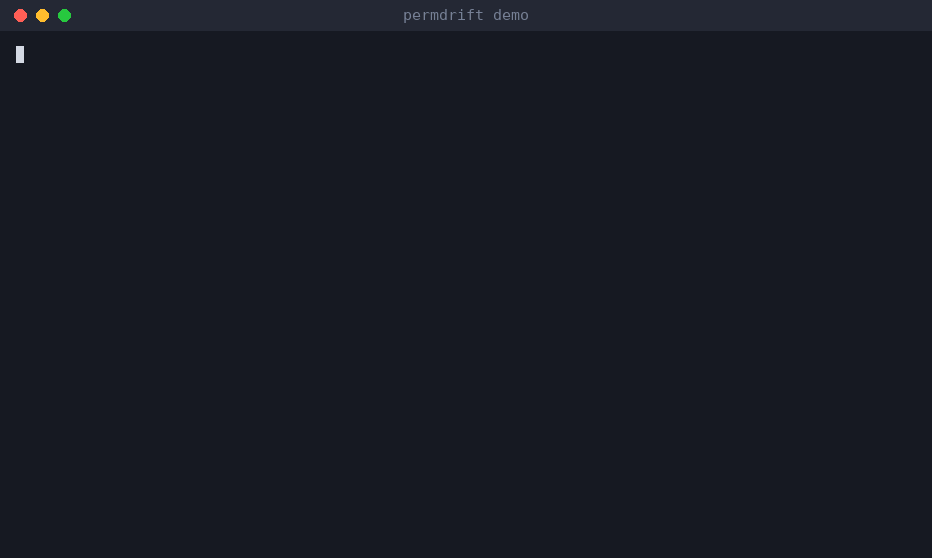
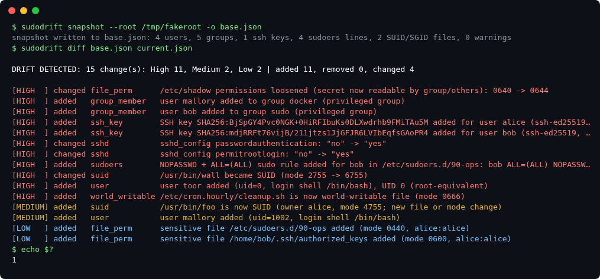
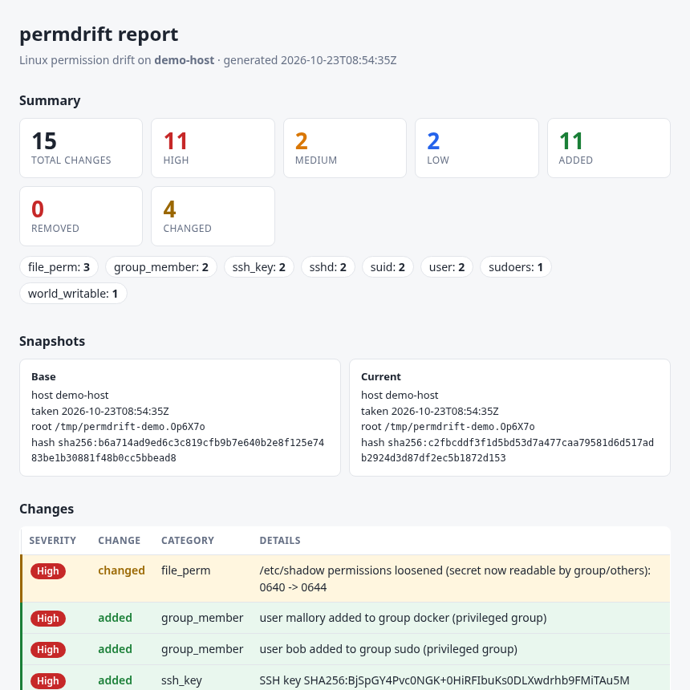

# sudodrift

**Linux Permission Drift Detector.** Snapshot the security-relevant permission state of a host, then see *what changed* in plain English: "SSH key SHA256:… added for user bob", "NOPASSWD sudo rule added", "user alice added to group sudo", "/usr/bin/wall became SUID".

Single static Go binary, standard library only, no daemon, no network access, no root required (root just gives better coverage).



A larger sample run as a static screenshot:



The same run as an HTML report (`sudodrift report`):



> Status: early (v0.4.0). It works and has tests, but expect rough edges and some changes to the JSON schema and severity rules.

## The problem

Access on a Linux box quietly drifts: someone adds a "temporary" NOPASSWD rule, an extra SSH key lands in `authorized_keys`, a binary gains the SUID bit, `/etc/shadow` becomes group-readable. Config management tells you what *should* be there; auditors and incident responders need to know what *is* there and *when it changed*. sudodrift gives you a small, diffable JSON baseline and a ranked list of access-relevant changes between two points in time.

## Install

Prebuilt static binaries for Linux (amd64 and arm64) are on the [releases page](https://github.com/sudodrift/sudodrift/releases/latest):

```sh
VER=v0.4.0; ARCH=amd64   # or arm64
curl -fsSLO https://github.com/sudodrift/sudodrift/releases/download/$VER/sudodrift_${VER#v}_linux_$ARCH.tar.gz
curl -fsSLO https://github.com/sudodrift/sudodrift/releases/download/$VER/SHA256SUMS
sha256sum -c SHA256SUMS --ignore-missing
tar xzf sudodrift_${VER#v}_linux_$ARCH.tar.gz
sudo install -m 0755 sudodrift /usr/local/bin/
```

On Debian, Ubuntu, Fedora or RHEL style systems you can also build `.deb` and `.rpm` packages with `goreleaser release --snapshot --clean` (see `.goreleaser.yaml`). I have not attached packages to a release yet.

With Homebrew on Linux (the tool is Linux only, so this does nothing useful on macOS):

```sh
brew install sudodrift/tap/sudodrift
```

The formula lives in [sudodrift/homebrew-tap](https://github.com/sudodrift/homebrew-tap) and installs the v0.4.0 release binary.

### Docker

The image is a static binary on `scratch`. Mount the host's root filesystem read only and point `--root` at it:

```sh
docker run --rm -v /:/host:ro ghcr.io/sudodrift/sudodrift:latest snapshot --root /host > base.json
```

The snapshot goes to stdout, so the redirect happens on the host. It reads the hostname from `/host/etc/hostname`, so the baseline carries the host's name and not the container's. Run it as root (the default in the container) or shadow state and other users' `~/.ssh` will be missing. The image is published to ghcr.io when a version tag is pushed, so it will only exist after the next tag. Until then, build it yourself with `docker build -t sudodrift .`. I could not test the Docker build on the machine where I wrote this, so tell me if it breaks.

### From source

To build from source you need Go 1.21+ (check with `go version`).

Quickest way:

```sh
go install github.com/sudodrift/sudodrift/cmd/sudodrift@latest
```

Or build from a clone:

```sh
git clone https://github.com/sudodrift/sudodrift.git sudodrift && cd sudodrift
# option A (needs make): builds ./bin/sudodrift, CGO disabled, static, version from git
make build
# option B (no make needed):
CGO_ENABLED=0 go build -trimpath -o bin/sudodrift ./cmd/sudodrift   # creates bin/ for you

./bin/sudodrift version
```

To put it on your `PATH`, either `sudo install -m 0755 bin/sudodrift /usr/local/bin/` or run `make install` / `go install ./cmd/sudodrift` (installs to `$(go env GOPATH)/bin`, usually `~/go/bin`, which you may need to add to `PATH`). The examples below assume `sudodrift` is on your `PATH`; otherwise use `./bin/sudodrift`.

## Usage

```sh
# 1. baseline (run as root for full coverage: shadow state, all ~/.ssh, sudoers)
sudo sudodrift snapshot -o base.json

# 2. later...
sudo sudodrift snapshot -o now.json

# 3. text diff; exit code 1 if drift was found (handy for cron/CI)
sudodrift diff base.json now.json

# 3a. print everything, but only exit 1 when something High shows up
sudodrift diff base.json now.json --fail-on high

# 3b. the same diff as JSON or CSV, for scripts and spreadsheets
sudodrift diff base.json now.json --format json
sudodrift diff base.json now.json --format csv > drift.csv

# 4. self-contained HTML report (inline CSS only, no external assets)
sudodrift report base.json now.json -o report.html

# 5. review bundle (zip) with both snapshots, the diff, the report and a review form
sudodrift evidence --base base.json --current now.json -o evidence-myhost-2026-10-23.zip

# 6. which sudoers lines will sudo-rs (Ubuntu 25.10 and 26.04) reject or treat differently?
sudo sudodrift sudors-check
```

Options:

| Flag | Applies to | Meaning |
|---|---|---|
| `-o FILE` | snapshot, report, evidence | output file (snapshot defaults to stdout, evidence to `evidence-HOST-DATE.zip`) |
| `--root DIR` | snapshot, sudors-check | scan a fake root instead of `/` (tests, mounted images, backups) |
| `--include-home` | snapshot | also walk `/home` for SUID and world-writable files (skipped by default for speed) |
| `--exclude a,b` | snapshot | extra directories to skip while walking |
| `--format text\|json\|csv` | diff | output format, default `text` |
| `--base FILE`, `--current FILE` | evidence | the two snapshots to compare (both required) |
| `--dir DIR` | evidence | write the bundle into a new or empty directory instead of a zip |
| `--force` | evidence | replace an existing zip file (otherwise it refuses) |
| `--ignore FILE` | diff, report, evidence | line-based ignore patterns (`.txt` or simple `.yaml` list) |
| `--min-severity low\|medium\|high` | diff, report, evidence | hide anything below this level |
| `--fail-on low\|medium\|high` | diff | exit 1 only if a shown change is at this level or above; output is unchanged |
| `--target NAME` | sudors-check | sudo-rs release to check against: `ubuntu-26.04` (default), `ubuntu-25.10` or `upstream` |
| `--fail-on breaks\|differs\|info` | sudors-check | exit 1 if a finding is at this level or above, default `breaks` |
| `--format text\|json` | sudors-check | output format, default `text` |

Flags may be written with one or two dashes (`-o` / `--root`) and may come before or after the file arguments. `sudodrift <command> --help` prints the options for each command, `sudodrift version` the version.

Exit codes: `0` no drift (or a file was written), `1` drift found (`diff` only), `2` error (bad arguments, unreadable/corrupt snapshot, unsupported schema version, an output file that already exists). These do not change with `--format`. `report` and `evidence` exit 0 even when drift is found; use `diff` for gating. With `--fail-on high`, `diff` still prints every change but exits 0 unless at least one of them is High. It only counts changes that are shown, so anything hidden by `--ignore` or `--min-severity` never fails the run.

Snapshots taken as an unprivileged user are partial (unreadable paths such as `/etc/sudoers` or other users' `~/.ssh` become warnings inside the snapshot, and `diff` notes it). Don't diff a non-root snapshot against a root one: the difference will show up as spurious "added" changes. With `--root DIR`, symlinks are resolved inside `DIR` (an absolute link such as `etc/passwd -> /etc/passwd` is re-rooted), so a scan of a mounted image never reads the live host.

### Ignore file

One wildcard pattern per line (`*` matches anything, including `/` and `:`). Patterns match `category:subject` or just `subject`. `#` comments, and `- "pattern"` YAML-list style, are accepted.

```
# ignore.txt
suid:/usr/bin/sudo
ssh_key:deploy:*
/usr/lib/*
user:build?
```

Categories: `user`, `group`, `group_member`, `ssh_key`, `sudoers`, `suid`, `world_writable`, `file_perm`, `sshd`. Ignores are applied when diffing/reporting, never when snapshotting, so the raw evidence stays complete.

### Output formats for diff

`--format text` is the default and prints what earlier versions printed.

`--format json` prints one JSON document. The `version` field is the layout version of this output (currently `1`). It changes only if a field is removed or changes meaning; new fields can be added without a bump, so parse it leniently.

```json
{
  "version": 1,
  "tool": "sudodrift",
  "tool_version": "0.4.0",
  "base":    {"hostname": "web1", "timestamp": "...", "content_hash": "sha256:...", "warnings": 0},
  "current": {"hostname": "web1", "timestamp": "...", "content_hash": "sha256:...", "warnings": 0},
  "ignored": 0,
  "summary": {"total": 2, "added": 1, "removed": 0, "changed": 1,
              "high": 1, "medium": 1, "low": 0, "by_category": {"sudoers": 1, "suid": 1}},
  "changes": [
    {"type": "added", "category": "sudoers", "subject": "...", "severity": "High", "message": "..."}
  ]
}
```

`changes` is an empty list (never `null`) when there is no drift. `severity` is `High`, `Medium` or `Low`.

`--format csv` prints a header row (`severity,type,category,subject,message`) and one row per change. Quoting of commas, quotes and newlines is done by Go's `encoding/csv`. Names in a snapshot come from the host and can be hostile, so any cell that starts with `=`, `+`, `-` or `@` (or a tab or carriage return) gets a single quote in front. That stops Excel, LibreOffice and Google Sheets from running it as a formula, and the quote shows up in the cell. If you feed the CSV to another program, strip a leading `'` first. Most real cells start with `/` or a word, so you will rarely see it.

JSON and CSV carry the same text as the text format, except that control characters are not escaped to `\x..` (JSON escapes them its own way, CSV keeps them in the quoted cell).

### Evidence bundle

```sh
sudodrift evidence --base base.json --current now.json -o evidence-web1-2026-10-23.zip
sudodrift evidence --base base.json --current now.json --dir ./evidence-web1   # plain directory
```

Without `-o` or `--dir` the zip is named `evidence-<host>-<date>.zip` (host from the current snapshot, made safe for a file name; date in UTC) and written to the current directory. The command will not overwrite an existing zip unless you pass `--force`, and `--dir` must be new or empty. Files are written with mode 0600 because snapshots describe your hosts.

The zip holds one top-level folder named after the zip file, with these files in it (a `--dir` bundle has the same files without the folder):

| File | What it is |
|---|---|
| `base.json`, `current.json` | the two input snapshots, byte for byte |
| `diff.txt`, `diff.json` | the diff in the text and JSON formats, with your `--ignore` and `--min-severity` applied |
| `report.html` | the same self-contained HTML report that `sudodrift report` writes |
| `metadata.json` | tool version, creation time (UTC), host names, snapshot times and content hashes, options used, change counts |
| `REVIEW.md` | a blank review form: reviewer name, date, and one approved / not approved line plus notes for each High finding |
| `MANIFEST.sha256` | SHA-256 of every other file, in `sha256sum` format |

Check a bundle after unzipping with `cd evidence-web1-2026-10-23 && sha256sum -c MANIFEST.sha256`.

What this is and is not: it puts the material for an access review in one place, with the filled-in review form as the part a person adds. It is **not** a compliance report, an attestation or a signature. The manifest only shows that the files were not changed after the bundle was made; anyone who can rewrite the bundle can rewrite the manifest too. If you need tamper evidence, sign or store the zip somewhere write-once yourself. Whether a bundle satisfies an auditor, or a control in SOC 2, ISO 27001 or anything else, is for you and the auditor to decide. The snapshots themselves still have the limits listed under "What it does not do" (partial coverage, heuristic severity).

### sudo-rs readiness check

Ubuntu 25.10 and 26.04 LTS use [sudo-rs](https://github.com/trifectatechfoundation/sudo-rs) as the default `sudo`. It reads the same `/etc/sudoers`, but it does not support everything original sudo does. When sudo-rs meets a line it does not support, it prints a syntax error and skips that whole line, so a rule that worked before an upgrade can stop granting access.

`sudodrift sudors-check` reads `/etc/sudoers` and every file it pulls in (`@include`, `@includedir`, `#include`, `#includedir`) and lists each line that sudo-rs rejects, ignores or treats differently. It only reads files and needs no network.

```sh
sudo sudodrift sudors-check                       # check this machine for Ubuntu 26.04
sudodrift sudors-check --root /mnt/image          # check a mounted image or a copy of /etc
sudodrift sudors-check --target ubuntu-25.10      # sudo-rs 0.2.8 rules instead of 0.2.13
sudodrift sudors-check --format json              # for scripts
sudodrift sudors-check --fail-on differs          # also exit 1 on "differs" findings
```

Every finding has a severity, a file and line, an explanation, a suggested fix and a link to the source it is based on:

- **breaks**: sudo-rs rejects the line and skips all of it.
- **differs**: sudo-rs accepts the line but it does not work the same way.
- **info**: worth knowing, usually nothing to do.

Exit codes: `0` nothing at the `--fail-on` level (default `breaks`), `1` at least one finding at that level or above, `2` usage or read error.

Output of `sudodrift sudors-check --root examples/sudors-check` (exit code 1):

```
sudo-rs readiness check, target ubuntu-26.04 (sudo-rs 0.2.13)
Files read: /etc/sudoers, /etc/sudoers.d/90-ops

INFO     /etc/sudoers:3  [defaults-ignored]
  line:   Defaults env_reset
  why:    env_reset is always on in sudo-rs, so this line has no effect.
  fix:    No change needed. You can remove the option.
  source: https://github.com/trifectatechfoundation/sudo-rs/blob/v0.2.15/README.md#differences-from-original-sudo

INFO     /etc/sudoers:4  [defaults-ignored]
  line:   Defaults mail_badpass
  why:    sudo-rs never sends mail, so mail_badpass has no effect. It is accepted for compatibility.
  fix:    No change needed. You can remove the option.
  source: https://github.com/trifectatechfoundation/sudo-rs/blob/v0.2.15/README.md#differences-from-original-sudo

BREAKS   /etc/sudoers:7  [defaults-unknown]
  line:   Defaults requiretty, timestamp_timeout=10
  why:    sudo-rs 0.2.13 does not know the Defaults option "requiretty" ("unknown setting"). sudo-rs does not implement requiretty on purpose (sudo-rs FAQ, "Why did you change X?"). sudo-rs reports a syntax error and skips the whole line, so nothing else on it takes effect either.
  fix:    Remove requiretty from this line, or move it to its own Defaults line so the other options still apply.
  source: https://github.com/trifectatechfoundation/sudo-rs/blob/v0.2.15/FAQ.md#why-did-you-change-x

BREAKS   /etc/sudoers.d/90-ops:2  [arg-wildcard]
  line:   Cmnd_Alias LOGROTATE = /usr/sbin/logrotate -f /etc/logrotate.d/*
  why:    Wildcard in argument /etc/logrotate.d/*. sudo-rs only allows a wildcard in arguments as a final, standalone * ("wildcards are not allowed in command arguments"). sudo-rs reports a syntax error and skips the whole line, so nothing else on it takes effect either.
  fix:    List the exact arguments allowed, or put a single * as the last argument to allow any arguments. Wildcards in the command path itself are still fine.
  source: https://github.com/trifectatechfoundation/sudo-rs/blob/v0.2.13/src/sudoers/tokens.rs#L196-L228

DIFFERS  /etc/sudoers.d/90-ops:5  [tag-ignored]
  line:   %ops ALL = (postgres) LOG_OUTPUT: /usr/bin/psql
  why:    The LOG_OUTPUT tag is ignored by sudo-rs. The rule still applies, but sudo-rs has no I/O logging or mail, and visudo -c from sudo-rs reports the tag ("this tag is ignored by sudo-rs").
  fix:    Remove LOG_OUTPUT:. Use auditd or session recording outside sudo if you need I/O logs.
  source: https://github.com/trifectatechfoundation/sudo-rs/blob/v0.2.13/src/sudoers/mod.rs#L754-L758

BREAKS   /etc/sudoers.d/90-ops:6  [host-wildcard]
  line:   %dba db*.internal = (postgres) /usr/bin/pg_ctl
  why:    Wildcard in host name db*.internal. The sudo-rs parser only accepts letters, digits, '.', '-' and '_' in host names ("expected host name"), even though its manual still describes host wildcards. sudo-rs reports a syntax error and skips the whole line, so nothing else on it takes effect either.
  fix:    List each host name, or use a Host_Alias, or ALL.
  source: https://github.com/trifectatechfoundation/sudo-rs/blob/v0.2.13/src/sudoers/tokens.rs#L80-L101

INFO     /etc/sudoers.d/90-ops:7  [sudoedit-files]
  line:   deploy ALL = sudoedit /etc/nginx/sites-available/app
  why:    This rule lets a user edit specific files with sudoedit. USN-8708-1 (1 September 2026) fixed a race in sudo-rs sudoedit that let such a user place files in any directory and possibly gain root. It only affects systems with fine-grained sudoedit rules like this one. On Ubuntu 26.04 the fix is in sudo-rs 0.2.13-0ubuntu1.2.
  fix:    Run apt update && apt upgrade, and check with: dpkg-query -W sudo-rs
  source: https://ubuntu.com/security/notices/USN-8708-1

Summary: 3 breaks, 1 differs, 3 info
```

The same run as JSON is in `examples/sudors-check.json`. Each rule and the sudo-rs source or Ubuntu document it comes from is listed in [docs/sudo-rs.md](docs/sudo-rs.md). The "breaks" results were compared line by line with `visudo -c` from the Ubuntu 26.04 and 25.10 sudo-rs packages and from upstream builds of 0.2.8, 0.2.13 and 0.2.15; that page shows how to repeat the comparison.

Limits: it does not expand aliases (a rejected `Cmnd_Alias` is reported on the alias line), it does not know about backports in a distribution package beyond what the targets describe, and it cannot see differences that are not in the sudoers file, such as the new password prompt or the missing I/O logging.

### Run it on a schedule

sudodrift has no daemon. To get regular snapshots, let systemd or cron run it. The files are in `examples/`:

- `examples/systemd/sudodrift-snapshot.sh`: takes a snapshot into `/var/lib/sudodrift/snapshot-YYYY-MM-DD.json` and keeps the newest 26 (about half a year of weekly runs; change it with `SUDODRIFT_KEEP`)
- `examples/systemd/sudodrift-snapshot.service` and `sudodrift-snapshot.timer`: run that script weekly
- `examples/cron/sudodrift.cron`: the same thing for `/etc/cron.d` if you do not use systemd
- `examples/systemd/sudodrift-check.sh`: the drift check described below

Install with systemd:

```sh
sudo install -m 0755 bin/sudodrift /usr/local/bin/sudodrift
sudo install -m 0755 examples/systemd/sudodrift-snapshot.sh examples/systemd/sudodrift-check.sh /usr/local/sbin/
sudo install -m 0644 examples/systemd/sudodrift-snapshot.service examples/systemd/sudodrift-snapshot.timer /etc/systemd/system/
sudo systemctl daemon-reload
sudo systemctl enable --now sudodrift-snapshot.timer
systemctl list-timers sudodrift-snapshot.timer    # shows the next run
sudo systemctl start sudodrift-snapshot.service   # take the first snapshot now
```

The snapshot directory is created with mode 0700. The service runs as root so it can read shadow state and every `~/.ssh`. It uses `ProtectSystem=strict`, but not `ProtectHome`, because that would hide the files it is meant to read. If you run it as a normal user you get a partial snapshot (see above).

Pick a baseline by copying a snapshot you trust, then compare the newest snapshot against it:

```sh
sudo cp /var/lib/sudodrift/snapshot-2026-10-23.json /var/lib/sudodrift/baseline.json
```

The check script is only this:

```sh
#!/bin/sh
set -eu
baseline=${1:?usage: sudodrift-check.sh BASELINE.json [SNAPSHOT_DIR]}
dir=${2:-/var/lib/sudodrift}
newest=$(ls -1 "$dir"/snapshot-*.json | sort | tail -n 1)
exec sudodrift diff "$baseline" "$newest"
```

The file in `examples/systemd/` adds a `-q` flag (print nothing unless there is drift, useful for cron mail), a check that the newest file is not the baseline itself, and an error when the directory is empty. Either way the exit status is the one from `sudodrift diff`: 0 no drift, 1 drift, 2 error. So `sudodrift-check.sh /var/lib/sudodrift/baseline.json || notify-me` works in a timer, a cron job or a CI step.

Things to know: the baseline lives in the same directory as the snapshots it is compared with, so an attacker with root can change both (see the tamper-evidence note above); copy it somewhere else if that matters. The weekly snapshot and the check are separate, so a change made and reverted between two runs is not seen. The shell scripts are covered by the Go tests (against a fake root), and I checked the unit files with `systemd-analyze verify`. I have not run the timer for a full week on a real server.

### Demo

`./scripts/demo.sh` (builds `bin/sudodrift` first if missing; `make demo` does the same) creates a fake root, snapshots it, tampers with it, snapshots again, then runs `diff` and `report`. A pre-generated result is committed:

- `examples/sample-report.html`: open in any browser
- `examples/sample-diff.txt`: text output
- `examples/sample-diff.json` and `examples/sample-diff.csv`: the same diff with `--format json` and `--format csv`

The demo also builds an evidence bundle in a temporary directory and checks its manifest with `sha256sum -c`. The bundle is deleted afterwards, so none is committed.

Note: in the demo the fake files are owned by whoever runs the script (not root), so "new SUID file" shows as Medium there; a SUID file owned by root is High.

## What it collects

- **Users** (`/etc/passwd`): UID/GID, home, shell, whether the shell allows login, UID-0 accounts, password state (`locked`/`set`/`empty`, from `/etc/shadow` when readable; hashes are never stored).
- **Groups** (`/etc/group`): members; `sudo`, `wheel`, `admin`, `docker`, `lxd` flagged as privileged.
- **authorized_keys** per user (`.ssh/authorized_keys`, `authorized_keys2`): key type, SHA256 fingerprint, comment, options. Key material is never stored.
- **sudoers** + `sudoers.d/*`: parsed logical lines; flags `NOPASSWD` (and `Defaults !authenticate`) and `ALL=(ALL)`-style grants.
- **SUID/SGID files** with owner, mode and SHA-256 of contents (detects a SUID binary being swapped).
- **World-writable files/dirs** in `/etc`, `/usr/bin`, `/usr/sbin`, `/usr/local/bin`, `/usr/local/sbin` (and `/home` with `--include-home`). Sticky directories are not flagged.
- **Permissions/owners of sensitive files**: `/etc/passwd|group|shadow|gshadow|sudoers|sudoers.d/*`, `/etc/ssh/sshd_config`, SSH host private keys, and every user's `~/.ssh` directory and files.
- A few `sshd_config` directives (`PermitRootLogin`, `PasswordAuthentication`, `PermitEmptyPasswords`, `PubkeyAuthentication`).
- Metadata: hostname, UTC timestamp, tool version, and a content hash (excludes hostname/timestamp, so an unchanged host produces the same hash).

Severity (High/Medium/Low) is a heuristic, e.g. High: key added for root/sudo user, NOPASSWD or `ALL=(ALL)` rule added, member added to a privileged group, new UID-0 user, SUID gained, world-writable system file, `/etc/shadow` loosened, `PermitRootLogin yes`.

## What it does *not* do

- It is **not a real-time monitor** or IDS: no daemon, no inotify, no alerting. It compares two snapshots you take.
- **Not tamper-evident.** Snapshots are plain JSON; an attacker with root can edit the host *and* the baseline. Store baselines off-host.
- **No package, service, network, firewall, cron, kernel-module or process coverage.** Permissions and access paths only.
- Sudoers parsing in `snapshot` is line-based: no alias expansion, no `#include` following beyond `sudoers.d`, no `visudo`-grade validation. (`sudors-check` follows includes, but it also does not expand aliases.) PAM, LDAP/SSSD users, `AuthorizedKeysCommand`, custom `AuthorizedKeysFile` paths and ACLs/capabilities/xattrs are not inspected.
- "became SUID" can only be said when the file was already in the baseline as SGID; otherwise the message says "is now SUID (new file or mode change)", because sudodrift does not inventory every file on disk.
- Unreadable paths become warnings in the snapshot; run as root for complete results.
- Linux only. Severity ratings are opinions, not verdicts.

## Similar projects (honest comparison)

sudodrift is not novel. Related tools I found while building it:

- **[statedrift](https://github.com/statedrift/statedrift)**: also a single static, stdlib-only Go binary for Linux host-state drift. Much broader (packages, services, network, firewall, containers, hash-chained tamper-evident history, evidence bundles). If you want broad host drift with integrity guarantees, look there first. sudodrift is narrower and focused on access/permission semantics and readable severity-ranked diffs.
- **[ProcDrift](https://github.com/Towelie/ProcDrift)**: Python tool that baselines execution, persistence and privilege state (processes, systemd units, cron, SUID/SGID, users/groups/sudo) and reports diffs for IR/threat hunting. Overlaps on privilege state; broader on execution/persistence.
- Others in the same space: `infradrift` (Python), `drift` (matthewvaishnav).

Heavier, more mature alternatives for the same job:

- **Wazuh**: full HIDS/SIEM platform with agents, file-integrity monitoring, rule sets, compliance dashboards.
- **osquery**: SQL over OS state. Query users, sudoers, SUID, authorized_keys and more at fleet scale (needs a daemon/fleet manager for history and diffing).
- **AIDE** (and Tripwire-style tools): file-integrity databases for content and permission changes. Very good, but gives byte-level deltas, not "this adds a NOPASSWD rule".

Pick sudodrift if you want a tiny, dependency-free binary and a human-readable access-drift report; pick those if you need continuous monitoring, fleet scale, or tamper-evidence today.

## Related tools

Other free tools from the [sudodrift](https://github.com/sudodrift) project:

- **[breach-checks](https://github.com/sudodrift/breach-checks)**: short, read-only shell scripts that check your machines for one real leak or supply chain incident each.
- **[agent-preflight](https://github.com/sudodrift/agent-preflight)**: lists what an AI coding agent will read and run in a folder before you start it, and flags what looks risky.
- **[releasedrift](https://github.com/sudodrift/releasedrift)**: finds GitHub release downloads in your code, checks that they are pinned to a SHA-256, and catches release files that were swapped.
- **[keydrift](https://github.com/sudodrift/keydrift)**: finds the API keys on your machine, without showing their values, and tells you which ones an incident exposed and what to rotate first.
- **[keyburn](https://github.com/sudodrift/keyburn)**: watches OpenAI and Anthropic usage per key and alerts you when a key looks stolen, from a sudden spike, a dormant key in use, or spend over a limit.

## Development

```sh
make test     # go vet + go test -race ./...
make build    # bin/sudodrift
```

Tests build temporary fake roots (passwd/group/shadow/sudoers/authorized_keys/SUID files) under `internal/fixture`; no root privileges needed. Layout:

```
cmd/sudodrift/        CLI
internal/snapshot/    collectors + JSON model
internal/diff/        semantic comparison + severity
internal/ignore/      ignore-file matcher
internal/report/      text, JSON, CSV and HTML output
internal/evidence/    evidence bundle (zip or directory)
internal/sudors/      sudo-rs readiness check (fixtures in testdata/)
internal/fixture/     fake-root builders (tests/demos)
scripts/demo.sh       end-to-end demo
examples/             sample output, systemd units, cron file, check script
```

## Roadmap

Free / open-source:
- More collectors: cron/systemd timers, PAM config, `AuthorizedKeysFile` overrides, capabilities, ACLs, shell-init files.
- `sudodrift check` against a policy file ("only these users may be UID 0 / in sudo").
- SARIF output for `diff`.
- Packaged releases (static binaries, deb/rpm), a `snapshot --since-last` workflow.

Possible paid / hosted ideas (not built):
- **Multi-host rollup**: central collection of snapshots, fleet-wide dashboard, "which hosts gained NOPASSWD this week".
- **Signed evidence bundles**: the bundles from `sudodrift evidence` are unsigned today; this would add hash-chained, signed snapshots with offline verification for auditors.
- **SOC 2 / ISO 27001 mapping**: tie findings to controls (access control, change management, least privilege) and produce audit-ready reports.
- Scheduled scans with alerting (Slack/email/webhook) and approval workflows for expected changes.

## Services

Need help setting this up, collecting SOC 2 / ISO 27001 access review evidence, or integrating it with your fleet? Open an [issue](https://github.com/sudodrift/sudodrift/issues) or contact me through my GitHub profile.

## Contributing

See [CONTRIBUTING.md](CONTRIBUTING.md) for the short version. Bug reports, false positives and missing-collector requests are welcome as [issues](https://github.com/sudodrift/sudodrift/issues). For code changes, open a pull request that includes a test (fake-root fixtures in `internal/fixture` make this easy), and run `gofmt`, `go vet ./...` and `go test -race ./...` first. Please keep the tool dependency-free (standard library only) and read-only: it must never modify the host it scans.

To report a security problem in sudodrift itself, see [SECURITY.md](SECURITY.md).

## License

MIT. See [LICENSE](LICENSE).
